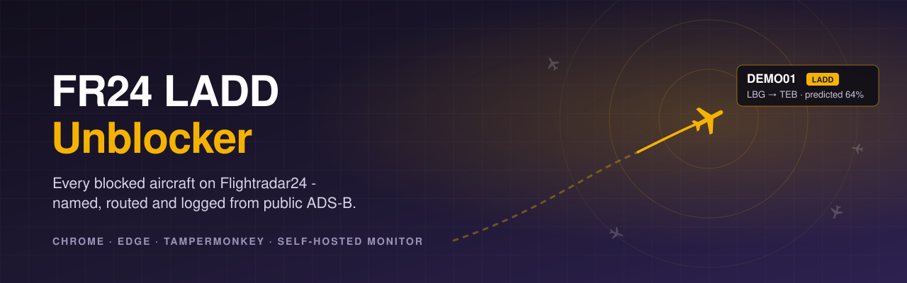
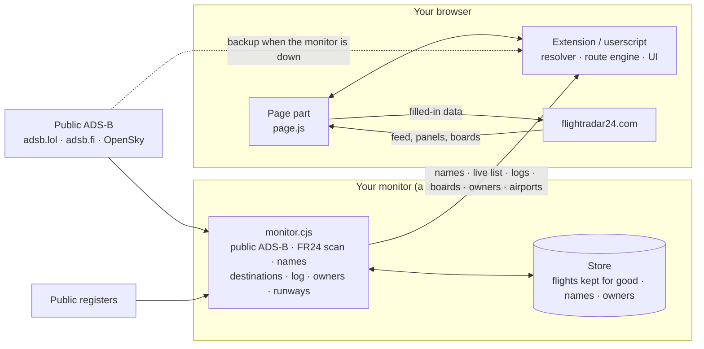

<p align="center">
  
</p>

<p align="center">
  <a href="CHANGELOG.md"></a>
  <a href="#install-the-browser-extension"></a>
  <a href="#or-the-userscript"></a>
  <a href="docs/monitor.md"></a>
</p>

<h3 align="center">Flightradar24 hides some aircraft. Their transponders don't.</h3>

<p align="center">
  Blocked and "N/A" flights on Flightradar24 get their name, owner, live data, destination and history back.<br>
  It is all built from public ADS-B and drawn inside FR24's own interface, so it looks like it was always there.
</p>

<p align="center">
  <a href="dist/fr24-ladd-unblocker-extension.zip"></a>
  &nbsp;
  <a href="dist/fr24-ladd-unblocker.user.js"></a>
  &nbsp;
  <a href="docs/monitor.md"></a>
</p>

<p align="center">
  <sub>Free for personal use · no account, no tracking, no ads</sub>
</p>

---

## ✨ What you get

| | | |
|:--|:--|:--|
| 🛩️ **Every blocked flight, named**<br><sub>Anonymous FR24 flights are matched to the transponder they really are. A server watches FR24's whole map, so flights over oceans, deserts and on the ground are named before you even look.</sub> | 🧭 **Where it's going**<br><sub>The take-off airport comes from the track. The destination is predicted by an explainable engine, with a probability and the reasons. It is only "Confirmed" when the aircraft is lined up on a runway.</sub> | 📒 **Every flight, logged**<br><sub>Each blocked aircraft's departures and arrivals are kept for good. They appear in FR24's own "Recent flights", its aircraft pages and its playback.</sub> |
| 🏷️ **The LADD tag**<br><sub>A yellow **LADD**, **PIA** or **MIL** tag on every aircraft it applies to: in the panel, in search and on airport boards.</sub> | 🏢 **Owners and operators**<br><sub>Names from public registers: the FAA, the UK's G-INFO, the Isle of Man, Switzerland. Looked up once on the server and kept. Names only, never addresses.</sub> | 🛬 **Airports, filled in**<br><sub>Blocked flights on arrival and departure boards worldwide. Movements per day, runway usage, every runway in full and the radio frequencies, where FR24 shows a padlock.</sub> |
| 📡 **Live telemetry**<br><sub>The padlocked fields filled from the transponder: vertical speed, squawk, GPS altitude, airspeeds, Mach, wind and temperature.</sub> | 📷 **Photos**<br><sub>JetPhotos first, then Planespotters, credited and cropped to FR24's frame.</sub> | 🧹 **A cleaner FR24**<br><sub>Advertisements and the advert sidebar removed, seamlessly. The map never stutters: background work waits for idle moments.</sub> |

## 📥 Download and install

Every version is also on the [Releases](../../releases) page, with its notes, once it is tagged.

### Install the browser extension

For **Google Chrome** and **Microsoft Edge** (and other Chromium browsers, version 111 or later).

1. **Download** [`fr24-ladd-unblocker-extension.zip`](dist/fr24-ladd-unblocker-extension.zip) (click **Download raw file**) and unzip it to a folder you'll keep.
2. Open `chrome://extensions` (or `edge://extensions`) and switch on **Developer mode**.
3. Click **Load unpacked** and choose the unzipped folder.
4. Open [flightradar24.com](https://www.flightradar24.com). That's it.

### …or the userscript

For any browser with [Tampermonkey](https://www.tampermonkey.net/).

1. Open [`dist/fr24-ladd-unblocker.user.js`](dist/fr24-ladd-unblocker.user.js) and click **Raw**. Tampermonkey offers to install it.
2. Open flightradar24.com and allow the data hosts when Tampermonkey asks (once each).

> Use **one or the other**, not both at once. If you switch to the extension, turn the userscript off in Tampermonkey.

### Connect your monitor

The extension works on its own. With a [monitor](docs/monitor.md) behind it, it knows every blocked flight worldwide from the moment FR24 opens, along with each aircraft's history.

Open any aircraft's panel, click **sources** on the strip under the photo, and enter your monitor's `https://` address and secret under **Shared monitor**. Both stay in your browser.

### Updating

Download the new zip, replace the folder's contents, and click **↻ Reload** on the extension's card. For the userscript, open the new file and click **Raw** again. What's new is in the [changelog](CHANGELOG.md).

## 🔍 How it works



**The monitor** runs all the time on a small server and does everything that has to be continuous and worldwide:

- It follows adsb.lol's worldwide **LADD**, **military** and **PIA** lists (every 10 seconds to 2 minutes), and every known blocked aircraft by address.
- It reads FR24's whole map every two minutes and names every flight FR24 shows without a callsign, from public ADS-B. Each named flight gets a rough destination.
- It logs every blocked aircraft's take-offs and landings for good, including flights only FR24 can see, with the runway used.
- It looks up each aircraft's owner once, and serves runway and frequency data for every airport.

**The browser** reacts to what you are looking at:

- It takes the monitor's whole names table the moment FR24 opens, so FR24's very first frame of any blocked flight is drawn named.
- It works out the full destination prediction for whatever is on screen.
- It writes everything into FR24's own data before FR24 draws it.
- If the monitor is unreachable, it identifies flights from public ADS-B on its own.

### How the destination is worked out

The engine scores **every plausible airport**, plus the hypothesis "a local flight returning home", on transparent, weighted evidence:

- **The aircraft's own history:** routes flown in each direction, what usually follows what, home base, overnight stops, weekdays and hours, cruise levels and the paths it flew.
- **The flight so far:** distance and heading against each great circle, descent profile, selected altitude, squawk and callsign.
- **Feasibility:** range, and runway length, width, surface and lighting for this aircraft type.
- **Everyone else's habits:** learned from 63 days of every aircraft adsb.lol saw, plus every blocked aircraft's flights as the monitor logs them, scored on aircraft held out of training.
- **Live conditions:** weather (METAR/TAF) and airport closures (NOTAMs, with an optional FAA key).

The result is a probability per airport, with the reasons in the tooltip. "Confirmed" is reserved for an aircraft established on a runway's final approach, which is right 99.8% of the time on held-out data. Full details are in [docs/architecture.md](docs/architecture.md).

## ☁️ Run your own monitor

The monitor is a single Node.js program (version 18 or later) with **no dependencies**. A free Oracle Cloud VM with 1 GB of RAM is enough.

```bash
node monitor/monitor.cjs        # try it locally: listens on 127.0.0.1:47524
```

On a server, from a checkout of this repository:

```bash
bash monitor/vm-setup.sh        # run the systemd service from the checkout, compressed HTTPS via Caddy
bash monitor/deploy.sh          # later: update to the newest commit, verify, roll back automatically on failure
```

Its dashboard is at `/dash`. Configuration, every endpoint, and day-to-day operation: [docs/monitor.md](docs/monitor.md).

## ❓ FAQ

<details>
<summary><b>Does it need a Flightradar24 account or subscription?</b></summary>

No. It works with a free account or none at all. It uses no paid feature and no one's login.
</details>

<details>
<summary><b>Why does a destination say "Predicted 64%"?</b></summary>

Blocked flights have no public flight plan. The destination is worked out from the evidence and shown with its probability. It turns "Confirmed" only on final approach to a runway. The tooltip lists the reasons.
</details>

<details>
<summary><b>Will it slow Flightradar24 down?</b></summary>

No. Background work runs in short slices while the browser is idle, and pauses while you drag or zoom the map. Main-thread stalls are measured on every change to the map path.
</details>

<details>
<summary><b>What if my monitor is down?</b></summary>

The extension carries on by itself, asking adsb.lol and adsb.fi directly. It keeps the last names it was given for six hours.
</details>

<details>
<summary><b>Does it work on a phone?</b></summary>

It is made for desktop browsers (Chrome, Edge, or any browser with Tampermonkey). It has not been tested on phones.
</details>

<details>
<summary><b>Is this legal?</b></summary>

It is built to be. Aircraft broadcast ADS-B openly, by law. The project uses only data that community networks and public registers already publish. It changes only what your own browser shows you. The reasoning, and its limits, are in [docs/legal.md](docs/legal.md).
</details>

## 🗂️ Data sources and responsible use

| Source | Used for | Access |
|---|---|---|
| [adsb.lol](https://adsb.lol) | Live positions, LADD / military / PIA lists, day traces | Free API, [ODbL](https://opendatacommons.org/licenses/odbl/) |
| [adsb.fi](https://adsb.fi) | Backup positions and military list, area lookups | Free open-data API |
| [OpenSky Network](https://opensky-network.org) | Backup worldwide positions | Anonymous API, limited credits |
| [airplanes.live](https://airplanes.live) | History files for days another network missed | Public history files (not its REST API) |
| ADS-B Exchange | Optional backup | Only with **your own** API key |
| Flightradar24 | The page you are looking at; the monitor's map scan | Public pages and feed, no account |
| [OurAirports](https://ourairports.com) | Airfields, runways, radio frequencies | Public domain |
| FAA, UK CAA G-INFO, Isle of Man, Swiss FOCA registers; hexdb.io, adsbdb.com | Owner names | Public registers; **names only, never addresses** |
| aviationweather.gov, FAA NOTAM API | Weather and closures | Public; NOTAMs only with your own key |
| OpenStreetMap | Names of private landing sites | [ODbL](https://www.openstreetmap.org/copyright) |

The project is built to be a **good citizen** of the free services it depends on:

- **Limits are respected.** The monitor sends at most 20 adsb.lol requests a minute and backs off on any refusal. Each register and database is asked at its own gentle pace.
- **Load is centralised.** One monitor asks once instead of every viewer asking.
- **No approval-gated APIs, no scraping of sites that ask scripts to stay away, and keys are always the user's own.**

Please use it for personal interest. Don't use it to track, follow or harass anyone. Every source, its terms and limits: [docs/data-sources.md](docs/data-sources.md).

## 🛠️ Development

```bash
npm install
npm run build        # dist/fr24-ladd-unblocker.user.js, dist/extension/ and the extension zip
npm run lint         # must report 0 errors
npm test             # build + every unit test + jsdom replays
npm run test:all     # + end-to-end runs against live FR24
```

Test conventions, fixtures and the release checklist: [docs/development.md](docs/development.md).

<details>
<summary><b>Repository layout</b></summary>

```
├── src/
│   ├── header.js            userscript header (@version, @connect hosts)
│   ├── page.js              page-world part: FR24 feed / API rewriting, Pinia hooks, airport panel
│   ├── engine.js            route engine (shared by the browser and the monitor)
│   ├── registry.js          aircraft registers (shared by the browser and the monitor)
│   ├── main/NN-*.js         modules: core, resolver, data, routes, UI, boards, boot
│   └── *.json               learned tables (packed into the build)
├── extension/               the extension's own parts: request shim, service worker, icons
├── monitor/
│   ├── monitor.cjs          the monitor service
│   ├── fr24.cjs             FR24's feed read from the server
│   ├── ident.cjs            naming FR24's callsign-less flights
│   ├── dest.cjs             rough destinations
│   ├── owners.cjs           owners and operators
│   ├── airport.cjs          runways, frequencies, runway used by each flight
│   ├── mkdata.cjs           builds the runway and frequency data from OurAirports
│   ├── dash.html            its dashboard
│   ├── deploy.sh, vm-setup.sh, merge-store.cjs
│   └── data/                airports, runways, frequencies, airfields
├── dist/                    the built extension (folder and zip) and userscript: install these
├── test/                    unit tests, jsdom replays, end-to-end, offline training pipeline
├── docs/                    architecture, monitor, data sources, development, legal
└── build.mjs                assembles the userscript and the extension
```
</details>

## 📚 Documentation

| Document | Contents |
|---|---|
| [docs/architecture.md](docs/architecture.md) | Components, data flows and the design decisions behind them |
| [docs/monitor.md](docs/monitor.md) | The monitor: configuration, what it keeps, API reference, server setup, operations |
| [docs/data-sources.md](docs/data-sources.md) | Every external source, its terms, limits and how it is used |
| [docs/development.md](docs/development.md) | Building, testing, fixtures, release checklist |
| [CHANGELOG.md](CHANGELOG.md) | Release history |
| [SECURITY.md](SECURITY.md) | Secrets, keys and reporting problems |
| [docs/maintainers/](docs/maintainers/) | Working notes: hand-over state, FR24 internals learned, standing requirements |

---

## ⚖️ Legal

Copyright © 2026 Finlay Clarke. Free to download and use for personal, non-commercial purposes under the [licence](LICENSE). Third-party data and trademarks are credited in [NOTICE.md](NOTICE.md). What the software does and doesn't do with data is in [PRIVACY.md](PRIVACY.md): in short, it collects nothing about you.

**Independent project.** Not affiliated with, endorsed by or connected to Flightradar24 AB, the FAA or any data provider named here. "Flightradar24" is a trademark of Flightradar24 AB, used only to say which website this works with.

**Why it is built to be lawful.** ADS-B is an unencrypted broadcast that aircraft are required by law to transmit. LADD is a programme governing the data the FAA itself hands to industry, not the broadcast. This project receives no radio, uses data that open networks and public registers already publish under their own terms, and changes only what its user's own browser shows. It decrypts, bypasses and republishes nothing, and it backs off whenever a source refuses. [docs/legal.md](docs/legal.md) sets out the reasoning in detail: broadcast law, LADD, data licences, privacy, Flightradar24's rights, and what it can and cannot do.

<sub>ADS-B data © <a href="https://adsb.lol">adsb.lol</a> contributors (ODbL), <a href="https://adsb.fi">adsb.fi</a>, <a href="https://opensky-network.org">OpenSky Network</a>, <a href="https://airplanes.live">airplanes.live</a>. Airport, runway and frequency data: <a href="https://ourairports.com">OurAirports</a> (public domain). Map features © <a href="https://www.openstreetmap.org/copyright">OpenStreetMap</a> contributors. Aircraft types: <a href="https://github.com/wiedehopf/tar1090-db">tar1090-db</a>. Not legal advice; the software comes with no warranty.</sub>
