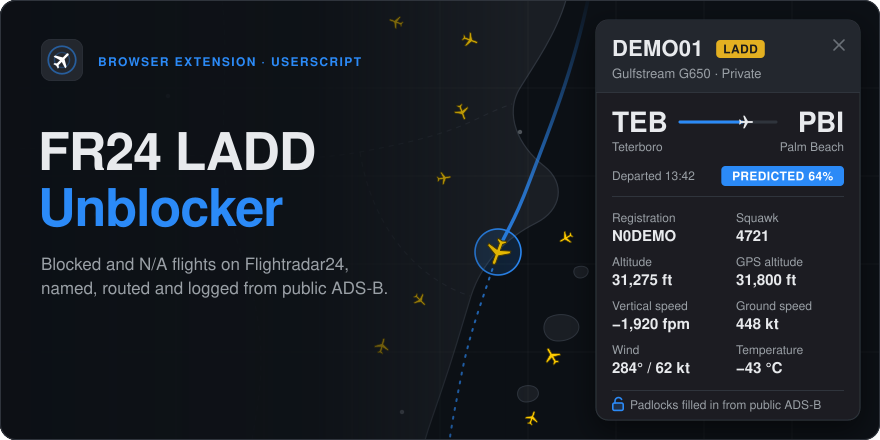
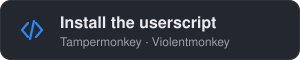
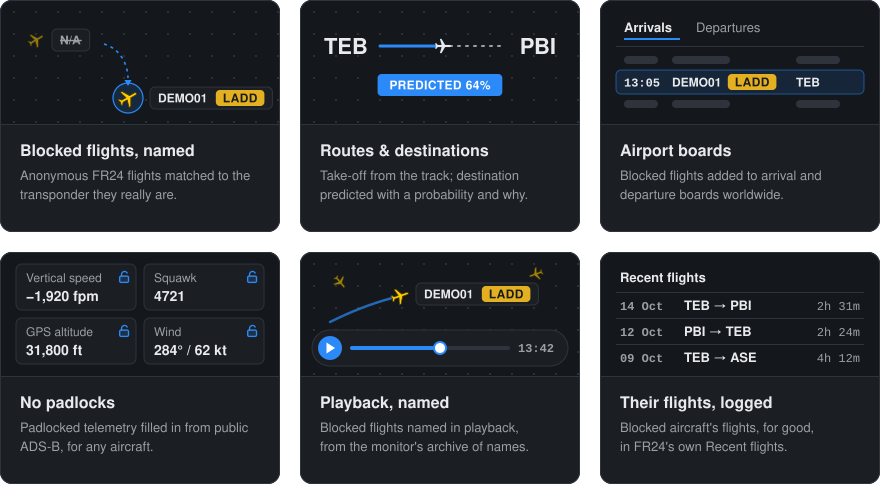
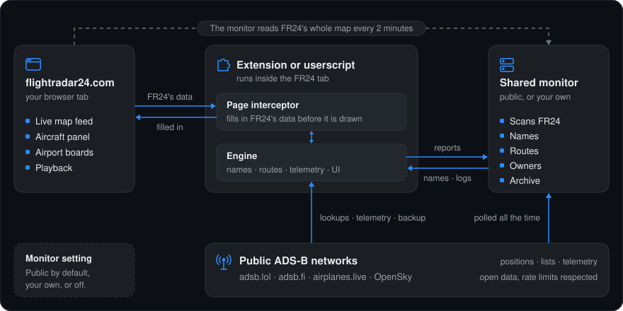

<div align="center">

<picture>
  <source media="(prefers-color-scheme: dark)" srcset="docs/assets/banner-dark.svg">
  <source media="(prefers-color-scheme: light)" srcset="docs/assets/banner-light.svg">
  
</picture>

<br><br>

<a href="CHANGELOG.md"></a>
<a href="PRIVACY.md#counting-installs"></a>
<a href="https://github.com/FinlayC1/fr24-ladd-unblocker/actions/workflows/tests.yml"></a>
<a href="LICENSE"></a>

<br>

A browser extension for Flightradar24. It names the flights FR24 hides or shows as "N/A", adds their route,<br>owner and history, and fills in the figures FR24 keeps behind a padlock, all from public ADS-B data.

<br>

<a href="https://github.com/FinlayC1/fr24-ladd-unblocker/releases/latest/download/fr24-ladd-unblocker-extension.zip"><picture><source media="(prefers-color-scheme: dark)" srcset="docs/assets/button-extension-dark.svg"><source media="(prefers-color-scheme: light)" srcset="docs/assets/button-extension-light.svg"></picture></a>&nbsp;&nbsp;<a href="https://github.com/FinlayC1/fr24-ladd-unblocker/raw/main/dist/fr24-ladd-unblocker.user.js"><picture><source media="(prefers-color-scheme: dark)" srcset="docs/assets/button-userscript-dark.svg"><source media="(prefers-color-scheme: light)" srcset="docs/assets/button-userscript-light.svg"></picture></a>

<sub>[Install](#install) · [Features](#features) · [How it works](#how-it-works) · [FAQ](#faq) · [Changelog](CHANGELOG.md)</sub>

</div>

## Features

<picture>
  <source media="(prefers-color-scheme: dark)" srcset="docs/assets/features-dark.svg">
  <source media="(prefers-color-scheme: light)" srcset="docs/assets/features-light.svg">
  
</picture>

Also:

- owners and operators from public registers (FAA, UK G-INFO, Isle of Man, Switzerland), names only, never addresses;
- the airport panel's padlocked parts filled in: movements per day, runway usage, every runway and the radio frequencies;
- photos from JetPhotos and Planespotters, credited;
- FR24's adverts removed, with background work kept to idle moments so the map never stutters.

## How it works

<picture>
  <source media="(prefers-color-scheme: dark)" srcset="docs/assets/how-it-works-dark.svg">
  <source media="(prefers-color-scheme: light)" srcset="docs/assets/how-it-works-light.svg">
  
</picture>

- **The monitor** is a small always-on server; every copy uses the shared one by default. It follows the worldwide LADD, military and PIA lists, reads FR24's whole map every two minutes to name every flight it shows without a callsign, logs every blocked aircraft's flights, and keeps the latest public ADS-B report of every aircraft it hears.
- **The extension** runs inside the FR24 tab. It takes the monitor's names the moment FR24 opens, works out destinations for what is on screen, and writes everything into FR24's own data before FR24 draws it. If the monitor is unreachable, it identifies flights on its own.
- **The two share the work.** The view is polled from the monitor and from public ADS-B in turn, and what each browser fetches is shared, so no one hits the networks' rate limits.

<details>
<summary><b>How the destination is worked out</b></summary>
<br>

The engine scores **every plausible airport**, plus the hypothesis "a local flight returning home", on transparent, weighted evidence:

- **The aircraft's own history:** routes flown in each direction, what usually follows what, home base, overnight stops, weekdays and hours, cruise levels and the paths it flew.
- **The flight so far:** distance and heading against each great circle, descent profile, selected altitude, squawk and callsign.
- **Feasibility:** range, and runway length, width, surface and lighting for this aircraft type.
- **Everyone else's habits:** learned from 63 days of every aircraft adsb.lol saw, plus every blocked aircraft's flights as the monitor logs them, scored on aircraft held out of training.
- **Live conditions:** weather (METAR/TAF) and airport closures (NOTAMs, with an optional FAA key).

The result is a probability per airport, with the reasons in the tooltip. "Confirmed" is reserved for an aircraft established on a runway's final approach, which is right 99.8% of the time on held-out data. Full details are in [docs/architecture.md](docs/architecture.md).
</details>

## Install

### Browser extension

For **Google Chrome**, **Microsoft Edge** and **Brave** (and other Chromium browsers, version 111 or later).

1. **Download** [`fr24-ladd-unblocker-extension.zip`](https://github.com/FinlayC1/fr24-ladd-unblocker/releases/latest/download/fr24-ladd-unblocker-extension.zip) from the latest release and unzip it to a folder you'll keep.<br><sub>Before the first release is tagged, take it from the repository instead: [`dist/fr24-ladd-unblocker-extension.zip`](dist/fr24-ladd-unblocker-extension.zip), then click **Download raw file**.</sub>
2. Open <kbd>chrome://extensions</kbd> (or <kbd>edge://extensions</kbd>, <kbd>brave://extensions</kbd>) and switch on **Developer mode**.
3. Click **Load unpacked** and choose the unzipped folder.
4. Open [flightradar24.com](https://www.flightradar24.com). That's it.

### Firefox

Firefox (desktop, version 140 or later) has its own build, [`fr24-ladd-unblocker-firefox.zip`](https://github.com/FinlayC1/fr24-ladd-unblocker/releases/latest/download/fr24-ladd-unblocker-firefox.zip), attached to each release. It is the file sent to [Firefox Add-ons](https://addons.mozilla.org) (add-on id `ladd-unblocker@finlayc1.github.io`); installed from there, Firefox keeps it up to date by itself. To try a build before it is listed, open <kbd>about:debugging#/runtime/this-firefox</kbd>, click **Load Temporary Add-on…** and choose the zip. Firefox removes it again when it restarts. The [userscript](#userscript) works in Firefox too.

### Userscript

For any browser with a userscript manager such as [Tampermonkey](https://www.tampermonkey.net/) or [Violentmonkey](https://violentmonkey.github.io/).

1. Open [`fr24-ladd-unblocker.user.js`](https://github.com/FinlayC1/fr24-ladd-unblocker/raw/main/dist/fr24-ladd-unblocker.user.js). Your userscript manager offers to install it.
2. Open flightradar24.com. If your manager asks you to allow the data hosts, allow them (once each).

> [!IMPORTANT]
> Use **one or the other**, not both at once. If you switch to the extension, turn the userscript off in your userscript manager.

### The monitor

Every copy of the script connects to the shared public monitor by default, so it knows every blocked flight worldwide from the moment FR24 opens, along with each aircraft's history. There is nothing to set up.

To turn it off, or point it at [your own monitor](#run-your-own-monitor), click **LADD Unblock** on FR24's bottom bar (next to Playback) and use the **Monitor** row under **Data sources**. An address and secret you enter there stay in your browser. With the extension, a monitor at an address of your own opens a page where your browser asks you to allow it, once. Turned off, your browser identifies what it sees on its own.

### The LADD Unblock window

Every setting is in one place: click **LADD Unblock** on FR24's bottom bar, next to Playback (or the version number on the strip under an aircraft's photo). It opens a window like FR24's own Widgets and Weather windows, with:

- **Enable LADD Unblock**, to switch the whole thing off and leave FR24 as it is (applies after a reload).
- A switch for each feature: the aircraft panel details, airport boards, search, aircraft and flight pages, take-off and landing alerts, and hiding ads and upgrade prompts.
- **Updates**: the version you have, the latest one, and an **Update** button.
- **Data sources**: which feeds are answering, the monitor, and your optional ADS-B Exchange and FAA NOTAM keys.

The switches are kept in your browser only.

### Updating

When a new version is out, a banner at the top of Flightradar24's map says so. Click **Update** on it, or in the LADD Unblock window.

- **Extension (Chrome, Edge):** a tab opens that puts the new version into the extension's folder for you. It downloads the new files from this repository's release, checks each one against the checksum the release lists, replaces the old files and deletes the ones the new version no longer has. Nothing else in the folder is touched. When it says it's done, click **Refresh page**: the extension restarts and Flightradar24 loads again with the new version.<br>The first time, Chrome asks you to choose the folder you unzipped the extension into and to allow it to be edited. Chrome never lets an extension write files without that. If you're not sure which folder it is, `chrome://extensions` shows it under the extension's **Details**, next to **Source**. Later updates are one click, though Chrome may ask you to allow editing again.<br>In a browser that doesn't let extensions write files (Brave, for one), the page links the new zip instead: unzip it over the old folder, then click **Reload extension** in the LADD Unblock window.
- **Firefox:** installed from Firefox Add-ons, Firefox updates it by itself.
- **Userscript:** **Update** opens the new file, and your userscript manager offers to update. Tampermonkey and Violentmonkey also check for updates on their own.

What's new is in the [changelog](CHANGELOG.md).

## Run your own monitor

The monitor is a single Node.js program (version 18 or later) with **no dependencies**. A free Oracle Cloud VM with 1 GB of RAM is enough.

```bash
node monitor/monitor.cjs        # try it locally: listens on 127.0.0.1:47524
```

On a server, from a checkout of this repository:

```bash
bash monitor/vm-setup.sh        # run the systemd service from the checkout, compressed HTTPS via Caddy
bash monitor/deploy.sh          # later: update to the newest commit, verify, roll back automatically on failure
```

Its dashboard is at `/dash`. Configuration, every endpoint, and day-to-day operation: [docs/monitor.md](docs/monitor.md).

## FAQ

<details>
<summary><b>Does it need a Flightradar24 account or subscription?</b></summary>
<br>

No. It works with a free account or none at all. It uses no paid feature and no one's login.
</details>

<details>
<summary><b>Why does a destination say "Predicted 64%"?</b></summary>
<br>

Blocked flights have no public flight plan. The destination is worked out from the evidence and shown with its probability. It turns "Confirmed" only on final approach to a runway. The tooltip lists the reasons.
</details>

<details>
<summary><b>Will it slow Flightradar24 down?</b></summary>
<br>

No. Background work runs in short slices while the browser is idle, and pauses while you drag or zoom the map. Main-thread stalls are measured on every change to the map path.
</details>

<details>
<summary><b>Do I need to run a monitor?</b></summary>
<br>

No. Every copy connects to the shared public monitor by default. You can turn it off, or use your own instead, under **Data sources** in the LADD Unblock window (see [The monitor](#the-monitor)).
</details>

<details>
<summary><b>What if the monitor is down?</b></summary>
<br>

The extension carries on by itself, asking adsb.lol and adsb.fi directly. It keeps the last names it was given for six hours.
</details>

<details>
<summary><b>Does it work on a phone?</b></summary>
<br>

It is made for desktop browsers (Chrome, Edge, Brave, or any browser with a userscript manager). It has not been tested on phones.
</details>

<details>
<summary><b>Is this legal?</b></summary>
<br>

It is built to be. Aircraft broadcast ADS-B openly, by law. The project uses only data that community networks and public registers already publish. It changes only what your own browser shows you. The reasoning, and its limits, are in [docs/legal.md](docs/legal.md).
</details>

## Development

```bash
npm install
npm run build        # dist/fr24-ladd-unblocker.user.js, dist/extension/ and the extension zip
npm run lint         # must report 0 errors
npm test             # build + every unit test + jsdom replays
npm run test:all     # + end-to-end runs against live FR24
```

Test conventions, fixtures and the release checklist: [docs/development.md](docs/development.md).

<details>
<summary><b>Repository layout</b></summary>

```
├── src/
│   ├── header.js            userscript header (@version, @connect hosts)
│   ├── page.js              page-world part: FR24 feed / API rewriting, Pinia hooks, airport panel
│   ├── engine.js            route engine (shared by the browser and the monitor)
│   ├── registry.js          aircraft registers (shared by the browser and the monitor)
│   ├── main/NN-*.js         modules: core, resolver, data, routes, UI, boards, boot
│   └── *.json               learned tables (packed into the build)
├── extension/               the extension's own parts: request shim, service worker, icons
├── monitor/
│   ├── monitor.cjs          the monitor service
│   ├── fr24.cjs             FR24's feed read from the server
│   ├── ident.cjs            naming FR24's callsign-less flights
│   ├── dest.cjs             rough destinations
│   ├── owners.cjs           owners and operators
│   ├── airport.cjs          runways, frequencies, runway used by each flight
│   ├── mkdata.cjs           builds the runway and frequency data from OurAirports
│   ├── dash.html            its dashboard
│   ├── deploy.sh, vm-setup.sh, merge-store.cjs
│   └── data/                airports, runways, frequencies, airfields
├── dist/                    the built extension (folder and zip) and userscript: install these
├── test/                    unit tests, jsdom replays, end-to-end, offline training pipeline
├── docs/                    architecture, monitor, data sources, development, legal; assets/ holds the graphics
├── site/                    the project website (GitHub Pages)
└── build.mjs                assembles the userscript and the extension
```
</details>

### Documentation

| Document | Contents |
|---|---|
| [docs/architecture.md](docs/architecture.md) | Components, data flows and the design decisions behind them |
| [docs/monitor.md](docs/monitor.md) | The monitor: configuration, what it keeps, API reference, server setup, operations |
| [docs/data-sources.md](docs/data-sources.md) | Every external source, its terms, limits and how it is used |
| [docs/development.md](docs/development.md) | Building, testing, fixtures, release checklist |
| [CHANGELOG.md](CHANGELOG.md) | Release history |
| [SECURITY.md](SECURITY.md) | Secrets, keys and reporting problems |
| [docs/maintainers/](docs/maintainers/) | Working notes: hand-over state, FR24 internals learned, standing requirements |

---

## Legal and privacy

| [Licence](LICENSE) | [Privacy](PRIVACY.md) | [Notices](NOTICE.md) | [Legal notes](docs/legal.md) | [Data sources](docs/data-sources.md) | [Security](SECURITY.md) |
|:-:|:-:|:-:|:-:|:-:|:-:|
| Personal, non-commercial use | No tracking, no accounts | Credits and trademarks | Why it is built to be lawful | Every source and its terms | Secrets and reporting |

Copyright © 2026 Finlay Clarke. Free to download and use for personal, non-commercial purposes under the [licence](LICENSE). Third-party data and trademarks are credited in [NOTICE.md](NOTICE.md). What the software does and doesn't do with data is in [PRIVACY.md](PRIVACY.md). In short: no tracking, no accounts and no advertising. The shared monitor receives only what it needs to answer your map, and you can turn it off.

**Independent project.** Not affiliated with, endorsed by or connected to Flightradar24 AB, the FAA or any data provider named here. "Flightradar24" is a trademark of Flightradar24 AB, used only to say which website this works with.

**Why it is built to be lawful.** ADS-B is an unencrypted broadcast that aircraft are required by law to transmit. LADD is a programme governing the data the FAA itself hands to industry, not the broadcast. This project receives no radio, uses data that open networks and public registers already publish under their own terms, and changes only what its user's own browser shows. It decrypts and bypasses nothing. Its shared monitor passes on only names, public-register owners (organisations only) and open ADS-B data, and the flights it logs are offered under the ODbL. It backs off whenever a source refuses. [docs/legal.md](docs/legal.md) sets out the reasoning in detail: broadcast law, LADD, data licences, privacy, Flightradar24's rights, and what it can and cannot do.

## Data sources and credits

| Source | Used for | Access |
|---|---|---|
| [adsb.lol](https://adsb.lol) | Live positions, LADD / military / PIA lists, day traces | Free API, [ODbL](https://opendatacommons.org/licenses/odbl/) |
| [adsb.fi](https://adsb.fi) | Backup positions and military list, area lookups | Free open-data API |
| [OpenSky Network](https://opensky-network.org) | Backup worldwide positions | Anonymous API, limited credits |
| [airplanes.live](https://airplanes.live) | History files for days another network missed | Public history files (not its REST API) |
| ADS-B Exchange | Optional backup | Only with **your own** API key |
| Flightradar24 | The page you are looking at; the monitor's map scan | Public pages and feed, no account |
| [OurAirports](https://ourairports.com) | Airfields, runways, radio frequencies | Public domain |
| FAA, UK CAA G-INFO, Isle of Man, Swiss FOCA registers; hexdb.io, adsbdb.com | Owner names | Public registers; **names only, never addresses** |
| aviationweather.gov, FAA NOTAM API | Weather and closures | Public; NOTAMs only with your own key |
| OpenStreetMap | Names of private landing sites | [ODbL](https://www.openstreetmap.org/copyright) |

The project is built to be a **good citizen** of the free services it depends on:

- **Limits are respected.** The monitor sends at most 20 adsb.lol requests a minute and backs off on any refusal. Each register and database is asked at its own gentle pace.
- **Load is centralised.** One monitor asks once instead of every viewer asking.
- **No approval-gated APIs, no scraping of sites that ask scripts to stay away, and keys are always the user's own.**

Please use it for personal interest. Don't use it to track, follow or harass anyone. Every source, its terms and limits: [docs/data-sources.md](docs/data-sources.md).

<sub>ADS-B data © <a href="https://adsb.lol">adsb.lol</a> contributors (ODbL), <a href="https://adsb.fi">adsb.fi</a>, <a href="https://opensky-network.org">OpenSky Network</a>, <a href="https://airplanes.live">airplanes.live</a>. Airport, runway and frequency data: <a href="https://ourairports.com">OurAirports</a> (public domain). Map features © <a href="https://www.openstreetmap.org/copyright">OpenStreetMap</a> contributors. Aircraft types: <a href="https://github.com/wiedehopf/tar1090-db">tar1090-db</a>. Not legal advice; the software comes with no warranty.</sub>

<sub>The aircraft, registration and flight shown in this page's illustrations (DEMO01, N0DEMO) are made up.</sub>
