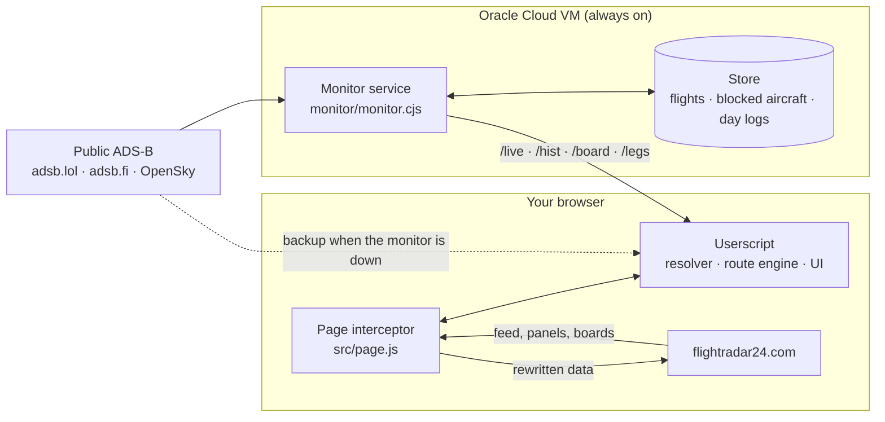

# FR24 LADD Unblocker

**Fills in what Flightradar24 hides: the identity, live data, route and history of blocked and "N/A" aircraft, rebuilt from public ADS-B and written into FR24's own interface so it looks native.**

| | |
|---|---|
| **Author** | Finlay Clarke |
| **Version** | 22.19.1 |
| **Components** | Browser userscript (Tampermonkey) + permanent monitor service (Node.js) |
| **Status** | Personal project, in daily use |

---

## Contents

1. [What it does](#what-it-does)
2. [Why it exists](#why-it-exists)
3. [How it works](#how-it-works)
4. [Installing the userscript](#installing-the-userscript)
5. [Running the monitor](#running-the-monitor)
6. [Data sources and responsible use](#data-sources-and-responsible-use)
7. [Development](#development)
8. [Repository layout](#repository-layout)
9. [Documentation](#documentation)
10. [Licence and acknowledgements](#licence-and-acknowledgements)

---

## What it does

Flightradar24 (FR24) withholds data for some aircraft. That includes those on the FAA's **LADD** list (*Limiting Aircraft Data Displayed*), aircraft FR24 hides of its own accord, many military and government aircraft, and flights with no filed route, which FR24 shows as **"N/A"**. On the map they appear as anonymous dots with padlocked fields.

The aircraft themselves still broadcast ADS-B, and community networks such as [adsb.lol](https://adsb.lol) and [adsb.fi](https://adsb.fi) publish what their receivers hear. This project joins the two:

- **Identification.** Every anonymous FR24 flight is matched to the public ADS-B transponder it really is, using position (dead-reckoned to the same moment), altitude, track, speed and type. Callsign, registration, type, operator, owner, age, serial number and country are then written into FR24's own data.
- **Live telemetry.** Padlocked fields are filled from the transponder: vertical speed, squawk, GPS altitude, airspeeds and Mach, wind and temperature.
- **Route and destination.** The take-off airport comes from the aircraft's track. The destination is **predicted** by a transparent, non-AI route engine (see [How the destination is worked out](#how-the-destination-is-worked-out)). It is shown as *Predicted* with a probability, and only marked *Confirmed* once the aircraft is lined up on a runway's final approach.
- **Flight history.** A log of up to seven months of flights is rebuilt from ADS-B history. It appears in FR24's own "Recent flights" list, its aircraft pages and its playback.
- **Airport boards.** Blocked and N/A flights are added to arrival and departure boards, with three days of history either side of now.
- **Photos.** JetPhotos first, then Planespotters, cropped to FR24's frame.
- **Cleaner FR24.** Advertisements and the advert sidebar are removed seamlessly.

Everything is drawn **inside FR24's own interface, in its own style**: identified flights look like ordinary traffic, not like an overlay.

## Why it exists

ADS-B is an unencrypted public broadcast. LADD limits what the FAA itself passes to commercial flight-tracking services; it does not stop the aircraft transmitting. The community networks that receive those transmissions publish them openly.

The result is an inconsistent picture: the same aircraft is visible on one site and anonymised on another. This project gives a single, consistent view in the tool the author already uses, built entirely from **publicly broadcast** data. See [Data sources and responsible use](#data-sources-and-responsible-use).

## How it works



The system has two halves.

**The monitor** (`monitor/monitor.cjs`) runs permanently on a small server. It does the work that must be continuous and worldwide:

- Polls adsb.lol's worldwide **LADD**, **military** and **PIA** (privacy-address) lists, and every other known blocked aircraft by address.
- Falls back to adsb.fi, OpenSky and, if you configure one, your own ADS-B Exchange key when adsb.lol rate-limits.
- Turns positions into flights (take-off, landing, airports) with the **same route engine** the userscript uses, and keeps them for 90 days.
- After each day ends, rebuilds every blocked aircraft's flights from adsb.lol's full-resolution day trace, in exactly the format the browser uses.
- Serves this over a small authenticated HTTP API: the live candidate list, flight logs, airport boards, parked aircraft.

**The userscript** (`dist/fr24-ladd-unblocker.user.js`) runs in the browser:

- A **page interceptor** (`src/page.js`) sits in FR24's page. It reads FR24's gRPC-web feed and JSON API answers, and writes identities, routes and telemetry back into them before FR24 renders anything.
- The **resolver** (`src/main/02-resolver.js`) matches anonymous flights to transponders, using the monitor's live list first.
- The **route engine** (`src/engine.js`) predicts destinations from the aircraft's history (served by the monitor), its track so far and population statistics learned offline.

**Why the work is split this way:**

- **Identification and history are continuous and worldwide.** They need someone listening all the time, so they live on the server. The browser no longer needs FR24 open to know where an aircraft went yesterday.
- **Destination prediction depends on what you are looking at.** It runs in the browser, where it can react instantly as the flight moves.
- **The browser stays useful on its own.** If the monitor is unreachable or its data is stale, the userscript goes back to asking adsb.lol and adsb.fi directly.

### How the destination is worked out

The engine scores **every plausible airport**, plus the hypothesis "a local flight returning home", on transparent, weighted evidence:

- **The aircraft's own history:** routes flown in each direction, what usually follows what, home base, overnight stops, weekdays and hours, its usual cruise level and the paths it flew each route by.
- **The flight so far:** distance and heading against each great circle, descent profile, selected altitude, squawk and callsign.
- **Feasibility:** range, and runway length, width, surface and lighting for this aircraft type.
- **Population statistics:** learned from 63 days of every aircraft adsb.lol saw, in tables scored on aircraft held out of training.
- **Live conditions:** weather (METAR/TAF) and airport closures (NOTAMs, with an optional FAA key).

The result is a probability per airport, with the reasons shown in the tooltip. "Confirmed" is reserved for an aircraft established on a runway's final approach; that rule is right 99.8% of the time on held-out data.

Full details are in [docs/architecture.md](docs/architecture.md).

## Installing the userscript

1. Install [Tampermonkey](https://www.tampermonkey.net/) in your browser.
2. Open `dist/fr24-ladd-unblocker.user.js` from this repository. Tampermonkey offers to install it. Alternatively, paste it into a new script in Tampermonkey's editor.
3. Open [flightradar24.com](https://www.flightradar24.com). Tampermonkey asks once per data host whether the script may connect to it; allow them.
4. Optional: point the script at your monitor. Open any aircraft's panel, click **sources** on the strip under the photo, then enter the monitor's `https://` address and its secret under **Shared monitor**. Neither leaves your browser.

Upgrading means replacing the script's code with the new build. Keep a copy of the previous version until the new one is confirmed working. A change to the header (for example, a new `@connect` host) needs a reinstall rather than an in-place edit.

## Running the monitor

The monitor needs Node.js 18 or later and has **no npm dependencies**. Run it locally with:

```bash
node monitor/monitor.cjs        # listens on 127.0.0.1:47524
```

It is designed to run permanently on a small server. A free Oracle Cloud VM (1 GB RAM) is enough: about 280 MB with 90 days of history. Setting up a server, the configuration options, every endpoint, the dashboard and day-to-day operation are covered in [docs/monitor.md](docs/monitor.md). The short version, on a fresh checkout on the server:

```bash
bash monitor/vm-setup.sh        # run the systemd service from this checkout; compressed HTTPS via Caddy
bash monitor/deploy.sh          # later: update to the newest commit, verify, roll back automatically on failure
```

A dashboard showing what the monitor is doing and who is calling it is served at `/dash`.

## Data sources and responsible use

| Source | Used for | Access |
|---|---|---|
| [adsb.lol](https://adsb.lol) | Live positions, LADD / military / PIA lists, day traces | Free API, [ODbL](https://opendatacommons.org/licenses/odbl/) |
| [adsb.fi](https://adsb.fi) | Backup positions and military list | Free open-data API, 1 request/s |
| [OpenSky Network](https://opensky-network.org) | Backup worldwide positions | Anonymous API, limited daily credits |
| [airplanes.live](https://airplanes.live) | History files for days another network missed | Public history files (not its REST API) |
| ADS-B Exchange | Optional backup | Only with **your own** RapidAPI key |
| [OurAirports](https://ourairports.com) | Airfields, heliports, runways | Public domain |
| FAA, Isle of Man, UK CAA (G-INFO), Swiss BAZL registers | Owner names | Public registers; **names only, never addresses** |
| aviationweather.gov, FAA NOTAM API | Weather and closures | Public; NOTAMs only with your own key |
| OpenStreetMap (Overpass) | Names of private landing sites | [ODbL](https://www.openstreetmap.org/copyright) |

The project is built to be a **good citizen** of the free networks it depends on:

- **Rate limits are respected.** The monitor sends at most 20 adsb.lol API requests a minute, at least 2 s apart, and backs off on any `429`. The browser stops asking for lists once the monitor answers.
- **Load is centralised.** History is fetched once on the server instead of per viewer.
- **APIs that require approval are not used.** That includes airplanes.live's REST API. Sites that ask scripts to stay away (`robots.txt`, bot challenges) are respected.
- **Keys are always the user's own.** They are entered by the user and stored only in their browser or server.

All aircraft data comes from public broadcasts and public registers. Please use the project for personal interest. Don't use it to track, follow or harass individuals.

Every source, its licence and how it is used are listed in [docs/data-sources.md](docs/data-sources.md).

## Development

```bash
npm install
npm run build        # dist/fr24-ladd-unblocker.user.js
npm run lint         # must report 0 errors
npm test             # build + every unit test + jsdom replays
npm run test:all     # + end-to-end runs against live FR24 (normal and Tampermonkey mode)
```

Some suites need outbound network access to FR24 and the ADS-B networks. Test conventions, the fixtures and the release checklist are covered in [docs/development.md](docs/development.md).

## Repository layout

```
├── src/
│   ├── header.js            userscript header (@version, @connect hosts)
│   ├── page.js              page-world interceptor: FR24 feed / API rewriting, Pinia hooks
│   ├── engine.js            route engine (shared by the userscript and the monitor)
│   ├── main/NN-*.js         userscript modules: core, resolver, data, routes, UI, boards, boot
│   └── *.json               learned tables (packed into the build)
├── monitor/
│   ├── monitor.cjs          the permanent monitor service
│   ├── dash.html            its dashboard
│   ├── deploy.sh            update + verify + roll back (server)
│   ├── vm-setup.sh          one-time server setup (systemd drop-in, Caddy compression)
│   ├── merge-store.cjs      merge another monitor's data into this one's
│   └── data/                airports, runways, airfields used by the monitor and the tests
├── dist/
│   └── fr24-ladd-unblocker.user.js   the built userscript - install this
├── test/                    unit tests, jsdom replays, end-to-end, offline training pipeline
├── docs/                    architecture, monitor, data sources, development, maintainer notes
└── build.mjs                assembles the single-file userscript
```

## Documentation

| Document | Contents |
|---|---|
| [docs/architecture.md](docs/architecture.md) | Components, data flows and the design decisions behind them |
| [docs/monitor.md](docs/monitor.md) | Monitor: configuration, API reference, server setup, operations |
| [docs/data-sources.md](docs/data-sources.md) | Every external source, its licence, limits and how it is used |
| [docs/development.md](docs/development.md) | Building, testing, fixtures, release checklist |
| [CHANGELOG.md](CHANGELOG.md) | Release history |
| [SECURITY.md](SECURITY.md) | Secrets, keys and reporting problems |
| [docs/maintainers/](docs/maintainers/) | Working notes: hand-over state, FR24 internals learned, standing requirements |

## Licence and acknowledgements

Copyright © 2026 Finlay Clarke. All rights reserved. No licence to copy, modify or redistribute is granted unless stated otherwise.

Not affiliated with, endorsed by or connected to Flightradar24 AB, the FAA or any of the data providers named above.

ADS-B data © [adsb.lol](https://adsb.lol) contributors (ODbL), [adsb.fi](https://adsb.fi), [OpenSky Network](https://opensky-network.org) and [airplanes.live](https://airplanes.live). Airport, heliport and runway data from [OurAirports](https://ourairports.com) (public domain). Map features © [OpenStreetMap](https://www.openstreetmap.org/copyright) contributors. Aircraft type data from [tar1090-db](https://github.com/wiedehopf/tar1090-db). FIR boundaries from the EUROCONTROL atlas.
