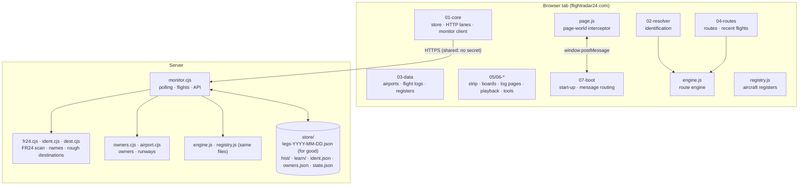
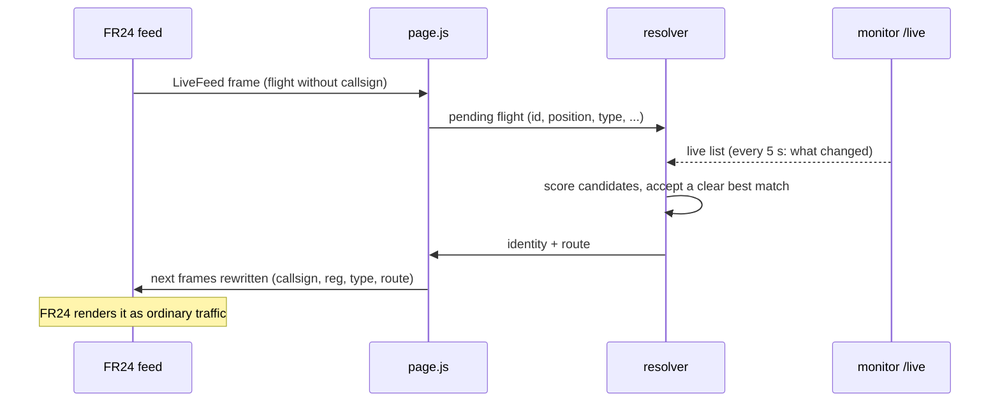
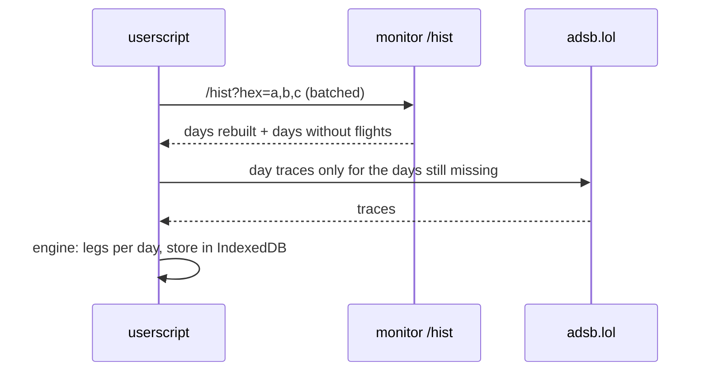

# Architecture

This document explains how the FR24 LADD Unblocker is put together, how data flows through it, and why it is designed the way it is.

- [1. Goals and constraints](#1-goals-and-constraints)
- [2. Components](#2-components)
- [3. The userscript](#3-the-userscript)
- [4. The monitor](#4-the-monitor)
- [5. Data flows](#5-data-flows)
- [6. Design decisions](#6-design-decisions)
- [7. Failure modes and fallbacks](#7-failure-modes-and-fallbacks)

---

## 1. Goals and constraints

| Goal | Consequence for the design |
|---|---|
| Blocked and N/A aircraft should look **native** in FR24 | Data is written into FR24's own feed and API answers before FR24 renders them. No overlays. |
| **No anonymous blocked flight anywhere**, over an ocean or a desert included, from the moment FR24 opens | The server scans FR24's whole map and names every callsign-less flight it draws, all the time. A browser takes the whole table on connect and gets the changes every 20 s. |
| **Responsiveness first**: the map must never stutter | All background work runs in short idle slices and pauses while the map is dragged or zoomed. Heavy jobs are moved to the server. |
| Predictions must be **honest and explainable** | No black-box model: weighted evidence terms with reasons. "Confirmed" only on a runway's final approach (99.8% on held-out data), otherwise at most 99%. |
| Never override FR24's own data | FR24's filed routes and airports always win. The script only fills what FR24 leaves empty. |
| Be **gentle** with free community networks | One centralised poller with a hard rate cap. Browsers stop polling lists once the monitor answers. Approval-gated APIs are not used. |
| Run for free | The monitor fits a 1 GB "Always Free" cloud VM and has no dependencies beyond Node.js. |

## 2. Components

| Path | Role |
|---|---|
| `src/header.js` | Userscript header: version, permitted hosts (`@connect`), grants |
| `src/page.js` | Runs in FR24's page context. Patches `XMLHttpRequest` (FR24's gRPC-web feed) and `fetch` (its JSON APIs), and hooks FR24's Vue/Pinia stores |
| `src/engine.js` | The route engine: trace parsing, leg reconstruction, airport inference, destination scoring. Shared verbatim by the userscript and the monitor |
| `src/registry.js` | The aircraft registers and databases (FAA, G-INFO, Isle of Man, FOCA, hexdb, adsbdb): where to ask and how to read each answer. Shared verbatim by the userscript and the monitor |
| `extension/shim.js`, `extension/background.js` | The browser extension's two extra parts: `GM_xmlhttpRequest` for the script, made by the extension's service worker |
| `src/main/01-core.js` | Local store (IndexedDB), per-host request lanes and rate limits, idle-slice scheduler, monitor client |
| `src/main/02-resolver.js` | Matching anonymous FR24 flights to ADS-B transponders |
| `src/main/03-data.js` | Airports, OurAirports fields, flight logs (`loadHistory`), registers, photos |
| `src/main/04-routes.js` | Composing each flight's route; FR24's "Recent flights" |
| `src/main/05-ui.js`, `06-*.js` | The strip under the photo, pop-overs and tools, airport boards, aircraft/flight pages, playback |
| `src/main/07-boot.js` | Start-up, message routing between page and userscript, test exports |
| `build.mjs` | Concatenates everything into one file and packs the learned tables (gzip + base64) |
| `monitor/monitor.cjs` | The permanent server-side poller and API |
| `monitor/fr24.cjs` | FR24's feed read from the server: the world scan and flight trails (gRPC-web, protobuf) |
| `monitor/ident.cjs` | Naming FR24's callsign-less flights from public ADS-B: the server's resolver |
| `monitor/dest.cjs` | A rough destination for every named flight |
| `monitor/owners.cjs` | Owners and operators, looked up once and kept |
| `monitor/airport.cjs` | Runways in full, frequencies, and which runway each tracked flight used |
| `monitor/mkdata.cjs` | Builds the runway and frequency data from OurAirports |

## 3. The userscript

### 3.1 Two worlds

Tampermonkey runs userscripts in an isolated context. FR24's own code runs in the page context. The script works in both:

- **Page world** (`page.js`, injected at `document-start`, before FR24's own code). It wraps FR24's network calls. Each feed frame (protobuf over gRPC-web) and API answer is read, then rewritten with identities, routes and telemetry *before FR24 decodes it*. FR24 then renders the result itself, so everything looks native. The same layer also:
  - hooks FR24's Pinia stores (playback state, the airport list, the sidebar), to hide adverts and keep learned private sites off the map;
  - pushes extra synthetic frames, so photos and routes appear without reopening a panel.
- **Userscript world** (`main/*`). It has cross-origin requests (`GM_xmlhttpRequest`), IndexedDB and all the logic. It talks to the page world with `window.postMessage`. Every message carries a type key, and messages from other origins are ignored.

The **browser extension** (Chrome/Edge, Manifest V3) is the same script without a userscript manager. `page.js` is declared as a content script in FR24's own world (`"world": "MAIN"`, at `document_start`). The rest runs as a content script in the extension's isolated world, where `extension/shim.js` provides `GM_xmlhttpRequest` by asking the extension's service worker (`extension/background.js`) to make the request. The hosts it may reach are the userscript's `@connect` list. `build.mjs` builds it into `dist/extension/` and a zip.

### 3.2 Identification (resolver)

FR24 reports blocked flights without callsign or registration, but with position, altitude, speed, track and usually the aircraft type.

**The monitor's names come first.** The monitor names every such flight FR24 draws anywhere (section 4.5). The browser takes its whole table the moment FR24 opens (`/fr24ids`), then every 20 s what changed. It hands the names straight to the page, so FR24's very first frame of any of those flights is drawn named, wherever it is. A flight on screen becomes a full identification at once (photos, owner, the browser's own route). The rest stay light until they are on screen. While the monitor's own FR24 scan works (`scanOk`), the browser runs no world scan of its own.

**The browser's own resolver is the backup.** Flights the monitor has no name for are matched here as before, against public ADS-B. Each name found here goes to the monitor with the browser's next report:

1. **Candidate list.** The monitor's live list (`/live`: the whole list once, then every 5 s only the aircraft heard again) holds every LADD, military, PIA and known blocked aircraft heard worldwide in the last 5 minutes. When the monitor is unavailable or stale, the userscript fetches adsb.lol's LADD and military lists and adsb.fi's military list itself.
2. **Scoring.** Each candidate is projected to the moment of FR24's report (dead reckoning on its own speed and track), then scored on:
   - distance;
   - altitude, track and speed differences;
   - type relation (same / same family / unknown / different, and different rejects it);
   - registration agreement;
   - list flags.

   A match is accepted only when it is clearly the best: the second candidate must score at least 2.5 worse or be more than 8 km away. The distance allowed grows with speed, since fast jets move several kilometres while two sources' clocks disagree.
3. **Area lookups.** Flights not in any list (ordinary N/A traffic) are matched against area queries of the map view, alternating sources.
4. **Out of coverage.** Over oceans or deserts the resolver compares FR24's own trail of the flight with:
   - candidates carried forward from where they were last heard;
   - the day's traces of blocked aircraft of the same type;
   - adsb.lol's heatmap ("who was where FR24's track was, at that time").

   One unambiguous agreement is required.
5. **Parked aircraft.** On an apron no public network hears, the resolver uses the monitor's `/parked`: the only blocked aircraft of that type whose last flight ended at this airport and which has not flown since.
6. **Verification.** Every identified flight keeps being checked against new reports. A match is withdrawn only on overwhelming disagreement: far apart, repeatedly, for more than 3 minutes.

### 3.3 Flight logs

`loadHistory(hex, days)` builds an aircraft's log, one day at a time:

1. **Monitor first.** For a blocked aircraft, the days the monitor has already rebuilt (`/hist`) are taken as they are. The same goes for days it watched without a gap and never heard the aircraft fly, which are known to have no flights.
2. **adsb.lol for the rest.** Missing days come from adsb.lol's day traces (`globe_history/YYYY/MM/DD/traces/xx/trace_full_<hex>.json`, about 40 days available). Older days come from airplanes.live's public history files.
3. **Second network for gaps.** A day with a flight whose take-off or landing was not heard is merged with the other network's trace of that day.
4. **Learning.** Each flight also feeds the self-learning store, where the engine learns this user's aircraft. The monitor ships the learning fields (squawk blocks, FMS levels, flow keys) with each flight it rebuilt, because those need the raw positions.

Logs are stored in IndexedDB and shared across FR24 tabs (`BroadcastChannel`).

**Parity guarantee:** the monitor rebuilds a day with the *same engine file*, the same options (`legsFromPoints` to the end of the day, `summarizeLeg` with the aircraft's earlier flights as context) and the same output format. `test/unit_monlive.cjs` checks that a log taken from the monitor is identical to the one the browser builds from adsb.lol itself.

### 3.4 Route engine

`engine.js` has three layers:

- **Trace to legs.** It parses readsb traces (positions, altitude, speed, flags, callsign changes) and splits them into legs at landings. Ground reports count, and so do slow gaps, final approaches and "lost low beside a field". It joins legs split by coverage holes and merges circuits.
- **Legs to airports.** Take-off and landing are placed at:
  - airports;
  - the OurAirports fields FR24 does not list;
  - learned private sites, for helicopters.

  Each end gets a confidence: `ground`, `low` or `near`.
- **Prediction.** Every candidate airport is scored with a conditional-logit model over transparent evidence terms. Weights are learned per flight situation (time since take-off, kind of aircraft, height, distance). The population tables and weights are produced offline by the `test/pipe_*.cjs` pipeline from 63 days of worldwide traffic, and evaluated on held-out aircraft.

Prediction is cheap (a few milliseconds per aircraft) and runs in idle slices.

**Learning from every blocked aircraft.** Besides the flights of the aircraft looked at here, the browser learns every blocked aircraft's completed flights worldwide. The monitor writes them as learning rows each day, and the browser takes the days it has not had yet (`/learn`, two weeks back at most, then every 3 hours). That covers where business aviation goes from where, squawk blocks, levels and flows.

### 3.5 Staying responsive

FR24 must stay smooth, so the userscript treats CPU time as scarce:

- **Idle slices.** `idleSlice()` / `sliced()` run background work 8 ms at a time, only when the browser is idle, and not at all while the user drags or zooms the map.
- **Large answers.** Day traces, the live list and other large answers are parsed in an idle moment, never inside the network callback.
- **Request lanes.** Each host has its own lane (concurrency and spacing). Background work never takes the last free slots, so the aircraft you click is never stuck behind it.
- **Measurement.** `test/perf.cjs` measures main-thread stalls over 50 ms during two minutes of map use. Every change on the map path is compared with the previous version.

### 3.6 The airport panel

On the map's airport panel, FR24 locks two pictures and leaves other parts out. The script fills them (`page.js`, `06-boards.js`):

- **Movements per day.** Each of the last days' take-offs and landings. FR24's own schedule is counted by local day, as on its statistics page, and the blocked flights the script knows from the monitor's log are added on top.
- **Runway usage.** The runways used by the flights the monitor tracked there in the last 7 days. Each runway is worked out from the flight's track (section 4.2), with how many flights that covers.
- **Airport & runway details.** Every runway in full: length, width, surface, lighting, and each end's heading, elevation and displaced threshold. Also the airport's radio frequencies (OurAirports, served by the monitor).
- **Removed:** the "Latest events" part and the plea to help FR24's ground coverage, with the box each sat in. A mutation observer removes them as FR24 adds them, before the browser draws the page, so they never show.

FR24 names its locked pictures `airport-panel__promo-…`. Where a picture has no such name, it is found under its title. The panel is redone whenever FR24 redraws it.

## 4. The monitor

### 4.1 Polling loop

A single loop sends **one request at a time**, at least 2 s apart, and never more than `apiPerMin` (default 20) adsb.lol API requests in any minute. Priority order:

| Every | What | Fallback when adsb.lol is paused or failing |
|---|---|---|
| 10 s | adsb.lol `/v2/ladd`: every FAA-LADD aircraft heard worldwide | OpenSky snapshot (below) |
| 30 s | adsb.lol `/v2/mil`: military aircraft worldwide | adsb.fi `/api/v2/mil`, then ADS-B Exchange (own key) |
| 120 s | adsb.lol `/v2/pia`: privacy (PIA) addresses | none; asked hourly if the endpoint 404s |
| 15 min max | OpenSky `/api/states/all`, keeping only known blocked aircraft | only while the LADD list has been silent for 3 minutes |
| 30 s | adsb.lol `/v2/hex/<100 hexes>` for blocked aircraft heard in the last 45 minutes and not on the LADD list ("hot") | none |
| 120 s | adsb.lol `/v2/point` for each area (home + up to 3 the user looked at) | adsb.fi `/api/v3/lat/…`, then ADS-B Exchange |
| 10 min | the same by address for every other blocked aircraft ("cold") | none |

With the 20-a-minute cap, a round of every list and the hot aircraft fits well within a minute. The browsers take the changes of the live list every 5 s.

A `429` pauses that host for 2 minutes. Refusals from OpenSky or airplanes.live pause them for 6 hours.

### 4.2 From positions to flights

Each report is appended to the aircraft's position rows. Every 2 minutes the rows go through the engine's `legsFromPoints` / `summarizeLeg`:

- Finished flights are stored and their positions released.
- A flight still under way stays open.
- A quiet aircraft (transponder off at the stand) is looked at again after 20 minutes, so its last flight is closed as landed.

Flights are written as one file per day (`legs-YYYY-MM-DD.json`). Blocked aircraft's flights are kept **for good**: a day's file is only ever added to, and the last 90 days are also held in memory. Other aircraft's flights are kept for 4 days. A board asked for older days reads them from disk.

Each take-off and landing at an airport also gets the **runway** used (`airport.cjs`). That is the runway end whose extended centreline the aircraft was on, going that way: down the final approach, or climbing out from the threshold. Positions are weighed by closeness to the centreline and agreement of track, and the answer is one clear runway or none.

### 4.3 Day logs (`/hist`)

Live polling samples every 30–60 s, which is coarser than adsb.lol's full traces, so it is not used for the browser's logs. Instead, 3 hours after each day ends (UTC), every blocked aircraft **heard in the air** that day is rebuilt from adsb.lol's full day trace. For a day with a flight whose take-off or landing was not heard, airplanes.live's file of the day is merged in. Each aircraft has one file (`hist/<hex>.json`, 90 days), read on request and never all held in memory.

A day can also be served as **"no flights"**, so the browser skips it entirely. The monitor claims that only when all of these hold:

- the day is over, and has been sent for rebuilding;
- the aircraft was known as blocked before the day began;
- the list that covers it watched it **without any gap over 200 s, all day**:
  - for an FAA-LADD aircraft that is the LADD list, and only if the aircraft was seen on that list with the LADD flag within 14 days of the day (an owner who left LADD is on no list);
  - for other blocked aircraft it is the address lookups;
- it was never heard airborne that day;
- no rebuild is pending or has failed for that day.

A day whose file never appears (retried every 2 hours for 36 hours), or whose rebuild fails, is marked unknown (`-1`). It is never claimed empty, and the browser reads it itself.

### 4.4 State and persistence

`state.json` holds:

- the blocked aircraft (registration, type, known since, last heard, FAA flag, last seen with the LADD flag);
- the areas;
- the watch record per day;
- the days still to rebuild;
- the time of the last run.

It is written atomically (temp file + rename) every 2 minutes and on `SIGTERM`/`SIGINT`, so a `systemctl restart` loses nothing. After downtime of more than 10 minutes, the days missed are read back from adsb.lol for every blocked aircraft.

### 4.5 FR24's flights: scanning, naming, rough destinations

**Scanning.** Every 2 minutes `fr24.cjs` reads FR24's whole map, the same LiveFeed requests the page makes. It covers 7 regions, quartering any area that reaches FR24's 1,500-flight limit (two levels at most). Requests carry the headers FR24's page sends. A browser hands over the ones it saw (never an authorization or cookie) and until then a plain set of the same kind is used. A refusal pauses the scan for 10 minutes, doubling up to 2 hours.

**Naming** (`ident.cjs`). Every flight FR24 draws without a callsign or registration is matched against every aircraft heard lately: the live list, the address lookups, and targeted adsb.fi area lookups around unnamed flights. The scoring is a port of the browser's resolver. Out of coverage it uses dead reckoning from where a blocked jet was last heard, then FR24's trail of the flight compared with the candidates' tracks. On the ground it uses the only aircraft of the type parked there. A name is withdrawn after four disagreeing reports over three minutes. A name a browser found itself is taken too. Names last as long as FR24 draws the flight.

**Rough destinations** (`dest.cjs`). Every named airborne flight gets one every 5 minutes. It runs the same engine and learned weights as the browser, on the flight's track (public ADS-B, then FR24's trail and scan positions where nobody else hears it), its take-off airport, and its earlier flights. It does not use the population tables (about 200 MB, too much for a 1 GB server), so it is "rough". The browser works out the full prediction for whatever is on screen. It also gives an estimated arrival time.

**Flights only FR24 sees** are logged too: once FR24 has stopped drawing one for 15 minutes, or has had it on the ground for 15 minutes. Its trail is fetched as it lands. The track is read as an ADS-B trace would be, and the flight is kept only when it reads as a landing at an airport. An ADS-B record of the same flight replaces it, and a finished ADS-B record missing an end takes that end from it.

**Owners** (`owners.cjs`). Every blocked aircraft's owner and operator is looked up once, from hexdb, adsbdb and its own register. The register code (`src/registry.js`) is the same as the browser's. Aircraft flying now go first, at one every 4 s, and each site is asked at its own pace. A site that refuses is left alone for a while. A browser asks the monitor before asking any register itself, and sends what it found (FR24's operator included) with its next report. The names table carries each aircraft's owner and operator.

### 4.6 API and security

**A monitor is public by default.** Every copy of the script connects to the shared one, reads it without a secret and reports to it. Reports from strangers are checked before they are used ([monitor.md](monitor.md#public-mode)):

- names against the monitor's own ADS-B data, or by two browsers agreeing;
- owners by two browsers agreeing;
- ADS-B reports for plausibility and against its own.

The owner's secret (`X-Monitor-Token`) opens the dashboard's numbers and the full answers, such as private owners' names and the areas being polled. On a private monitor (`MON_PUBLIC=0`), every endpoint except `/dash` requires it. The secret is never put in a URL, because reverse proxies log URLs. Each address is limited to `MON_RATE` requests a minute (300 on a public monitor), and the owner never is. The monitor listens on `127.0.0.1` only, with HTTPS (Caddy) in front of it. The endpoints are listed in [monitor.md](monitor.md#api-reference).

**Shared polling and the padlocked figures.** The monitor keeps the newest public ADS-B report of every aircraft it hears (`tel.cjs`). A browser polls its map from the monitor (`/near`) every other time and from adsb.lol / adsb.fi itself in between. It sends what its own polls found back every 30 s. For the aircraft just clicked, it asks the monitor (`/tel`) and its own source at once and draws the first answer. The page then clears every padlock FR24 draws (`page.js`, `unlockFeed`). It fills them from those reports, or with the vertical speed from FR24's own altitudes and the airspace from the FIR/UIR boundaries when no receiver has them.

## 5. Data flows

### Identifying a blocked flight

### Building an aircraft's log

## 6. Design decisions

**Server for continuity, browser for interaction.** The monitor listens all the time and worldwide, which a browser tab cannot do. The browser reacts instantly to what is on screen, which the server cannot. Prediction stays in the browser. History and identification candidates come from the server.

**Names on the server, handed over at once.** Identification used to happen only for flights in a browser's view, so a blocked jet over the Atlantic stayed "N/A" until someone looked at it and its trail was matched. The server now watches FR24's whole map and names flights as they appear. Their names wait in a table any browser takes in full on connect. The browser's own matching stays as the backup.

**FR24's map read from the server: a risk, contained.** Automated reading of FR24's feed is not something FR24's terms allow. The server's address could be refused or blocked at any time. The design keeps that from mattering. The scan is gentle (one request every 0.4 s, a round every 2 minutes) and backs off on any refusal. When it stops working (`scanOk` false) the browsers go back to their own world scan, and everything else the monitor does (public ADS-B, logs, owners) is unaffected.

**One engine, two places.** `engine.js` is the same file in both. This removes a whole class of disagreement between what the map, the boards and the logs say, and lets the monitor build logs the browser can use unchanged.

**Full-resolution traces for logs.** Live 30-second samples are good enough to place airports for boards, but not to reproduce the browser's logs exactly: take-off and touchdown times, circuits, and paths at fixed minutes. So day logs come from the same full traces the browser would fetch, fetched once on the server instead of once per viewer.

**Conservative empty days.** Telling the browser "no flights that day" saves many requests. Wrongly claiming it would silently delete flights from a log. Every condition in 4.3 exists to make a wrong claim impossible in the cases that can be foreseen. When in doubt, the day is left for the browser to fetch.

**Explicit fallbacks.** Every external dependency has a defined degraded mode (section 7), and a failing source never blocks the others.

**No dependencies on the server.** Only Node's standard library: nothing to audit, nothing to update, and it fits a 1 GB VM (about 280 MB at 90 days of history).

**Tests on real data.** Fixtures are recorded traces and FR24 answers from real flights the user reported (M-ARNZ, G-BOIL, OK-FLN, …). Fixes are proven against the case that exposed the bug.

## 7. Failure modes and fallbacks

| What fails | What happens |
|---|---|
| Monitor unreachable | The userscript polls adsb.lol / adsb.fi lists itself and fetches all log days from adsb.lol. The `127.0.0.1` monitor is not asked when a shared one is configured. |
| Monitor's LADD list > 90 s old | The userscript uses its own LADD and military lists |
| Monitor's military list > 3 min old | The userscript fetches the military list only |
| adsb.lol rate-limits the monitor | 2-minute pause. Military list and areas go to adsb.fi (then ADS-B Exchange with a key). After 3 silent minutes, OpenSky supplies blocked aircraft positions. |
| A day's trace is not published | Retried every 2 hours for 36 hours, then marked unknown for the browser |
| airplanes.live refuses the server | 6-hour pause. Affected days are marked for the browser to complete. |
| Monitor restarts | State saved on `SIGTERM`. Gap days re-read on start. `deploy.sh` rolls back a version that does not answer. |
| FR24 changes its internals | The interceptor only rewrites what it recognises. Unknown data passes through untouched. |
| FR24 refuses the monitor's scan | 10-minute pause, doubling to 2 hours. `scanOk` turns false and browsers run their own world scan. Names already given stay until their flights end. |
| A register or database refuses the monitor | That site is left alone for 10 minutes (`429`) or an hour (`401`/`403`). Its aircraft are retried an hour later, and browsers still look them up themselves. |
| Monitor down when FR24 opens | The browser shows the last names it kept (6 hours) and identifies on its own until the monitor answers. |
